<!-- Generated by build.mjs. Edit the content there, then run: node build.mjs -->

<a href="https://ardayildiz.me">
  <picture>
    <source media="(prefers-color-scheme: dark)" srcset="assets/banner-dark.svg">
    
  </picture>
</a>
